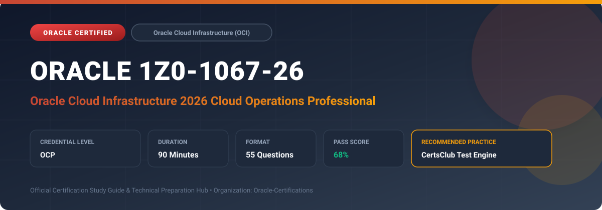

  

# Oracle 1Z0-1067-26: Oracle Cloud Infrastructure 2026 Cloud Operations Professional

[-red?style=for-the-badge)](https://education.oracle.com/)

---

## 1. Exam Overview & Candidate Profile

The **Oracle 1Z0-1067-26: Oracle Cloud Infrastructure 2026 Cloud Operations Professional** examination is designed for cloud professionals, enterprise architects, implementation consultants, and systems administrators who demonstrate deep practical knowledge and operational competence in deploying, configuring, and optimizing Oracle technologies.

The Oracle Cloud Infrastructure 2026 Cloud Operations Professional (1Z0-1067-26) certification verifies modern operational capabilities on OCI. It highlights Site Reliability Engineering (SRE) practices, automated drift detection with Resource Manager, proactive remediation via Cloud Guard, advanced FinOps cost management, and container/Kubernetes (OKE) fleet operations.

### Target Audience & Prerequisites
- **Target Roles**: Implementation Consultants, Cloud Solution Architects, DevOps/SysOps Engineers, and Enterprise Functional Analysts.
- **Recommended Experience**: 1–2 years of hands-on experience in configuring, administering, or implementing the relevant Oracle solutions.
- **Credential Earned**: Oracle Certified Professional (OCP).

---

## 2. Key Exam Specifications

| Specification | Details |
| :--- | :--- |
| **Exam Code** | **Oracle 1Z0-1067-26** |
| **Official Title** | Oracle Cloud Infrastructure 2026 Cloud Operations Professional |
| **Certification Track** | Oracle Cloud Infrastructure (OCI) |
| **Exam Duration** | 90 Minutes |
| **Number of Questions** | 55 Questions |
| **Passing Score** | 68% |
| **Question Format** | Multiple Choice (Single/Multiple Answer), Scenario-Based Questions |
| **Delivery Provider** | Oracle University / Pearson VUE (Online Proctored or Test Center) |
| **Recommended Practice Engine** | [CertsClub Oracle Practice Tests](https://www.certsclub.com/oracle/1z0-1067-26-dumps.html) |

---

## 3. Official Blueprint & Exam Domain Breakdown

The examination assesses candidate competencies across core functional domains weighted as follows:

| Domain Area | Weighting |
| :--- | :--- |
| **Advanced Automation, GitOps, & Resource Manager** | `25%` |
| **Full-Stack Observability (Metrics, Traces, APM)** | `25%` |
| **Infrastructure Reliability & Hybrid Cloud Management** | `20%` |
| **Proactive Security, Zero Trust, & Cloud Guard Responders** | `15%` |
| **FinOps, Cost Optimization, & Multi-Region DR** | `15%` |

---

## 4. Deep Dive into Complex & Challenging Technical Topics

To secure a passing score on the 1Z0-1067-26 exam, candidates must master the following advanced concepts:

- Configuring automated infrastructure drift detection and rollback in OCI Resource Manager.
- Deploying OCI Application Performance Monitoring (APM) and distributed tracing for microservices running on OKE.
- Implementing automated Cloud Guard security problem remediation using custom Event-driven OCI Functions.
- Configuring dynamic routing gateways (DRG v2) with cross-tenancy peering and transit routing.

---

## 5. Scenario-Based Demo & Practice Questions

### Question 1
In OCI 2026 operations, how can an SRE team automatically remediate a security problem detected by Cloud Guard (such as a publicly accessible Object Storage bucket) without human intervention?

A) Cloud Guard must send an email to the security administrator to manually click a button
B) Enable an automated Managed Responder Rule in Cloud Guard
C) Cloud Guard cannot modify cloud resources
D) By terminating the compartment immediately

- **Correct Answer**: `B) Enable an automated Managed Responder Rule in Cloud Guard`
- **Technical Explanation**: Cloud Guard provides automated responder recipes (e.g. Make Bucket Private) that immediately execute remediation actions when a detector rule detects a configuration violation.

---

### Question 2
What tool in OCI Resource Manager helps operations teams detect out-of-band modifications made to cloud resources directly via the console or CLI that differ from the Terraform state?

A) Drift Detection
B) State Migration
C) Schema Validation
D) Plan Encryption

- **Correct Answer**: `A) Drift Detection`
- **Technical Explanation**: Resource Manager Drift Detection compares the real-world state of provisioned infrastructure against the stored Terraform state file, highlighting all discrepancies.

---

## 6. Recommended Preparation Strategy & Practice Testing Engine

Achieving certification in **Oracle 1Z0-1067-26** requires balanced theoretical study and scenario-based simulation practice:

1. **Review Oracle Documentation**: Master architecture guides, implementation workbooks, and administration manuals on the Oracle Help Center.
2. **Hands-on Lab Practice**: Execute real-world configuration, policy setup, and troubleshooting tasks in your cloud tenancy or test instance.
3. **Simulated Exam Drills**: Practice answering timed, scenario-based multiple-choice questions to familiarize yourself with the question formats, traps, and timing constraints.

### Practice With CertsClub
For realistic practice questions, updated dumps, and mock testing environments:
- **Resource**: [CertsClub Oracle Practice Test Engine](https://www.certsclub.com/oracle/1z0-1067-26-dumps.html)
- **Special Discount**: Use coupon code **`club20`** during checkout for an instant **20% discount** on all practice exam bundles and testing engines.

---

## 7. Official Documentation & References

- [Oracle University Certification Registry](https://education.oracle.com/)
- [Oracle Help Center Documentation Portal](https://docs.oracle.com/)
- [Oracle Cloud Infrastructure & Applications Guides](https://docs.oracle.com/en/cloud/)
- [CertsClub Oracle Certification Exam Practice](https://www.certsclub.com/oracle/1z0-1067-26-dumps.html)

---

## 8. SEO & Discovery Keywords

`oracle 1z0-1067-26`, `oracle 1z0-1067-26 exam`, `oracle 1z0-1067-26 dumps`, `1Z0-1067-26 practice questions`, `1Z0-1067-26 study guide`, `oracle 1z0-1067-26 syllabus`, `oracle cloud infrastructure 2026 cloud operations professional`, `certsclub 1z0-1067-26`